<h1 align="center">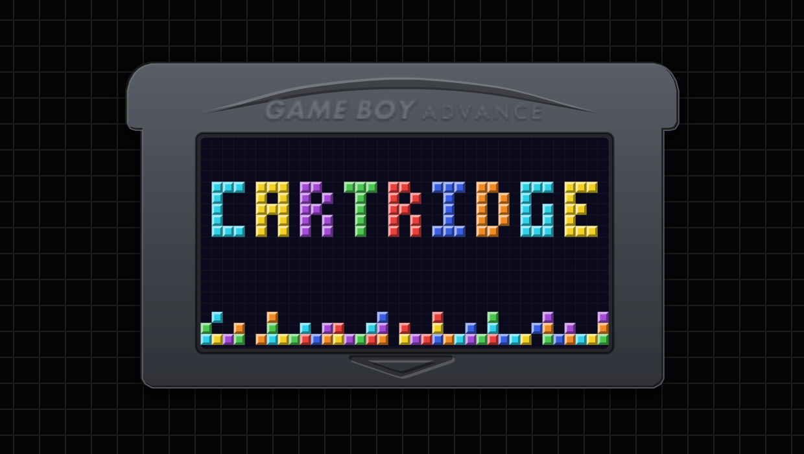</h1>

<b>A shelf of real-looking cartridges and discs for Anbernic H700 handhelds.</b> 
Pick a game off the shelf, pull it down into the handheld and play: GBA, GBC, GB, Game Gear, NES,
SNES, Master System, Mega Drive, PC Engine, PlayStation and Nintendo DS, on
<a href="https://github.com/pvaibhav/BaseOS">BaseOS</a>.

<a href="https://github.com/NukeBomB3000/cartridge/releases"><b>Download</b></a> ·
<a href="CHANGELOG.md"><b>Changelog</b></a> ·
<a href="https://oauramos.github.io/omega-zero/"><b>Upstream site</b></a> ·
<a href="https://github.com/oauramos/omega-zero/wiki"><b>Upstream wiki</b></a>

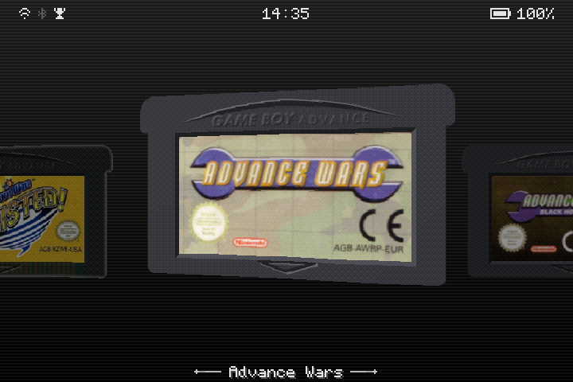
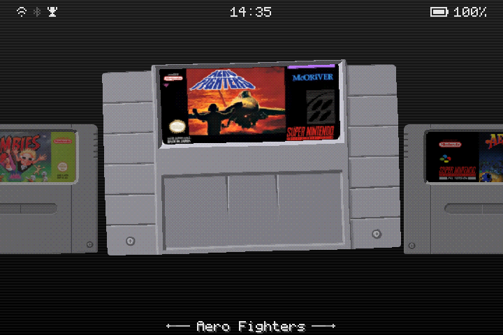
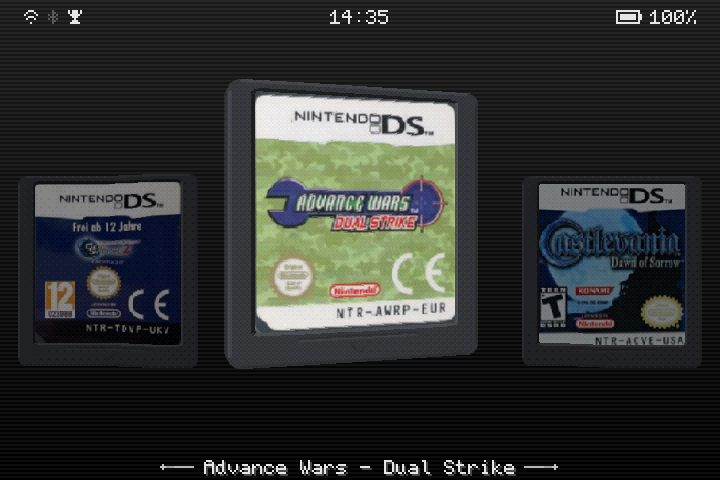

## Why Cartridge

Most custom firmware gives you a list of file names. Cartridge gives you a shelf of the games
themselves, each modelled after the real thing, with its own label scan, and then gets out of the
way: one button to play, one to resume, nothing to set up first.

- **It looks and feels like a collection.** Every system has its own carts or discs in their real
  shapes and plastics, drawn the way a PlayStation drew 3D, with the label scanned for each game.
  The one you are on floats, sways and does tricks; the back is modelled too. Seventeen colour
  themes, backgrounds after real handhelds, and a CRT shader that follows each console's lines.
- **The right emulator for every system, one tap away.** Gambatte for the Game Boys (it takes
  40 to 56 % less CPU than mGBA, which is battery), DSperate for the Nintendo DS, PCSX ReARMed or
  SwanStation for the PlayStation, mGBA or gpSP for the GBA, and more. The core is chosen per game
  on a drawing of the console's mainboard.
- **Everything is in the box.** RetroAchievements (softcore), a game menu with the game's guide,
  its achievements and the settings, a five-band equalizer, save states with a switcher, rewind,
  fast-forward, link play between two handhelds, Wi-Fi, Bluetooth and SSH, all without leaving
  the shelf.
- **Easy on the battery and the card.** Each system gets the CPU clock it needs, the handheld
  sleeps by itself and powers off a few minutes later, and the autosave spares the card.
- **Picks up where you left it.** It resumes the last game at boot, or opens the shelf on the cart
  you last looked at.
- **One build for the H700 family.** It reads the model from BaseOS at boot and lays itself out
  for its panel, from 640x480 to the square RG CubeXX, with the panel at 120 Hz where it can.
- **Open source** under the GPL, installed by copying a folder to a card.

Cartridge is a fork of [omega-zero](https://github.com/oauramos/omega-zero), itself a fork of
[slot](https://github.com/BrandonKowalski/slot). It keeps omega-zero's shelf, screens and cores and
adds a Nintendo DS emulator, more cores to choose from, a lot of looks to change and a few things
slot's other fork, [slot-fragile](https://github.com/fragilesilver/slot-fragile), did first. The
crates, the binary and the settings file carry the new name; an old `omega-zero.state` is moved
over on first boot.

## What it adds to omega-zero

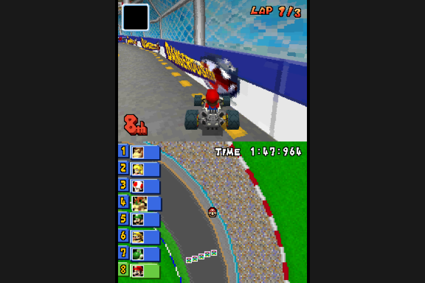
 Nintendo DS: its own card model on the shelf, and both screens in one picture

- **Nintendo DS** from `Games/NDS`, on [DSperate](https://github.com/beebono/DSperate) built from
  source with an automatic frameskip. Both screens share one picture with the top one large; R2
  fast-forwards and L2 swaps the screens, and there is no stylus. SELECT+MENU opens a pause menu
  after DSperate's own, with save and load state, the save states, a short list of options,
  resume and quit.
- **A choice of core, on a board of its own.** X on the shelf opens the core picker on a drawing
  of the console's mainboard: a Game Boy board (DMG-BEAN-02's look) to pick between Gambatte and
  mGBA, PlayStation's PU-18 to pick between PCSX ReARMed and SwanStation.

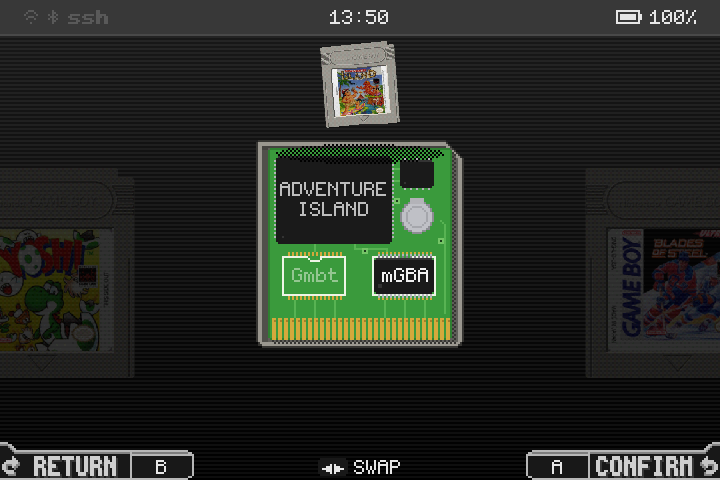
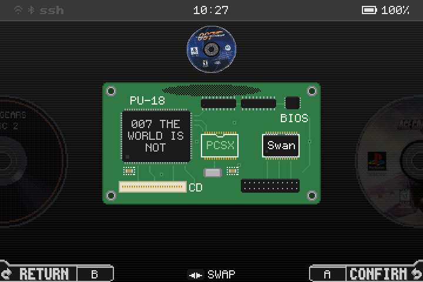
 Core pickers: Game Boy and PlayStation

- **Gambatte** runs the Game Boy and Game Boy Color games, built from source: on the RG SP it takes
  40 to 56 % less CPU than mGBA for the same game, which is battery. A Game Boy-only game runs as on
  the original, where SELECT+L2/R2 changes its palette; mGBA stays one press away, and link play
  asks for it.
- **SwanStation** (the libretro DuckStation) for the PlayStation, drawing in software at the
  PlayStation's own size on a thread of its own: on the RG SP that is more than twice as fast as
  the GPU renderer was, so it has none: it always draws in software. PCSX ReARMed stays the default.

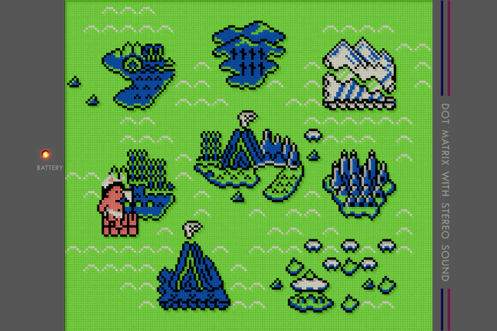
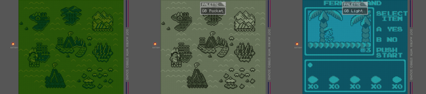
 Game Boy palettes on SELECT+L2/R2

- **Cart colours.** Y on the shelf paints the cart: twelve pigments, among them Ruby Red,
  Sapphire Blue, Emerald Green and Atomic Purple, in solid, clear or glittered plastic, kept per
  game.
- **Looks to change:** seventeen theme colours, backgrounds after real handhelds (Game Boy, DS,
  3DS, PSP and Switch), a text logo and a boot logo of a GBA cart, a CRT shader that follows each
  console's lines, ghosting for the television's consoles, and finer brightness steps whose
  lowest is the dimmest picture you can still see.
- **A five-band equalizer** in Settings, with a test sound, for the handhelds' small speakers.
- **The in-game menu has three tabs**, Guide, Achievements and Settings, in the theme's colours: the
  game's guide, its achievements with points and what is still locked, and a list for brightness,
  volume, screen look, palette and the running core's own options.
- **RetroAchievements**, softcore: sign in under Settings > Achievements and the game in the core is
  followed for unlocks, which pop up over it in the theme's colours. Saves, states, rewind and
  fast forward all stay on; there is no hardcore mode.
- **Sleep and power off by themselves:** after ten idle minutes the handheld sleeps, any button wakes
  it; three minutes into any sleep, lid shut included, it powers off. Both times are set in
  Settings > Sleep.
- **Battery and card:** each system gets the CPU clock it needs, and the autosave writes a game's
  save every minute but its resume state every five, so the card is spared.

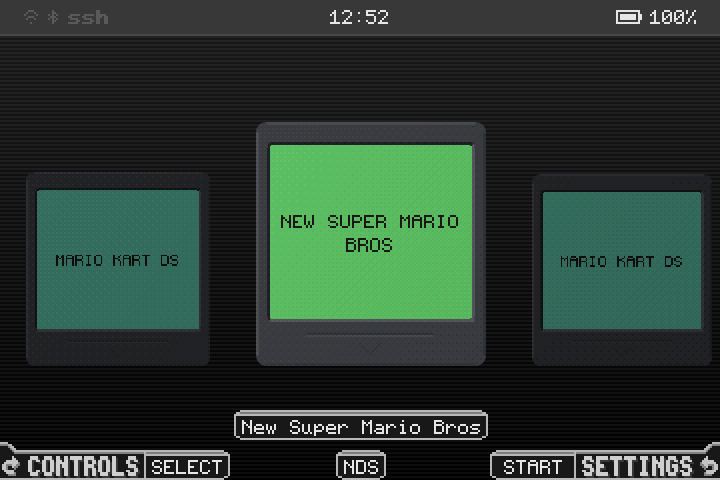
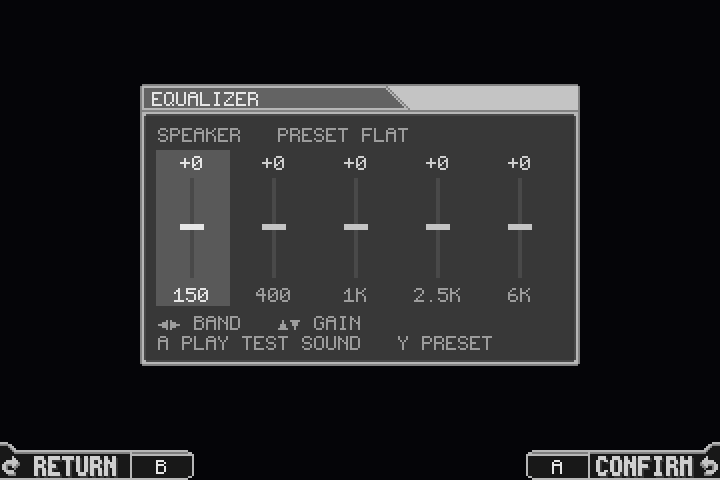
 Cart colours, and the equalizer

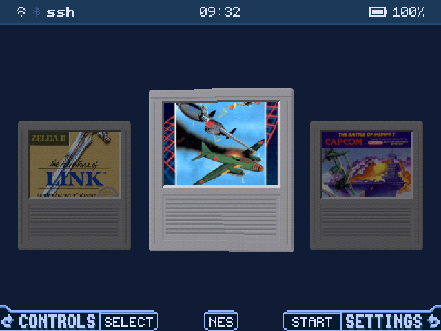
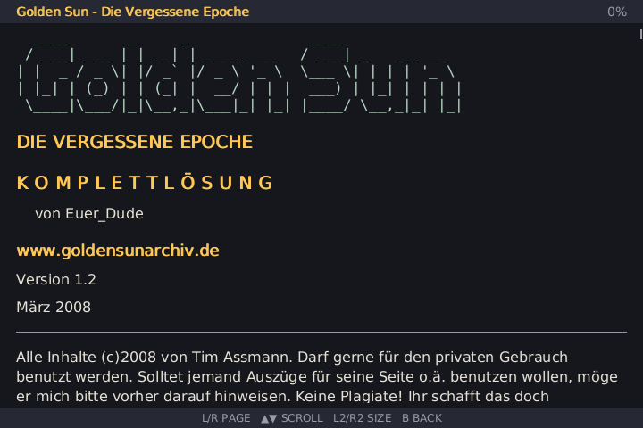
 A shelf in the blue theme, and a game guide

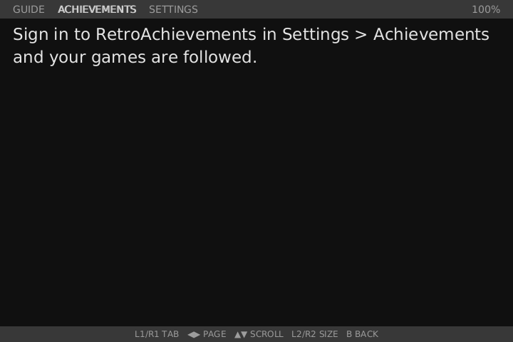
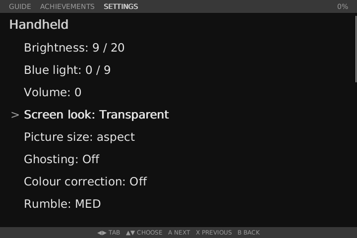
 The game menu's Achievements and Settings tabs

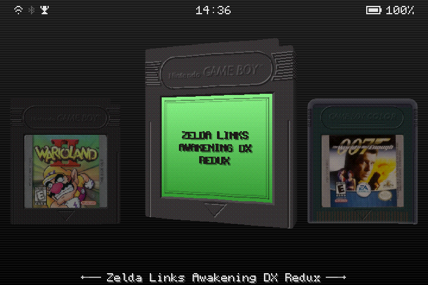
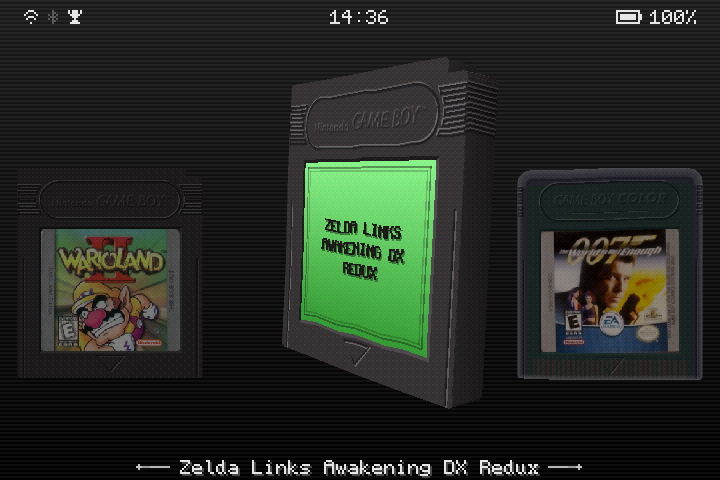
 A label made for a game with no artwork, and a cart doing one of its tricks

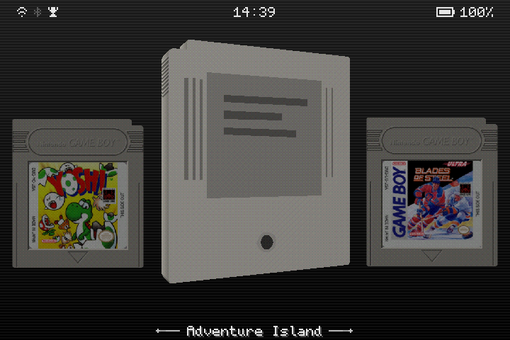
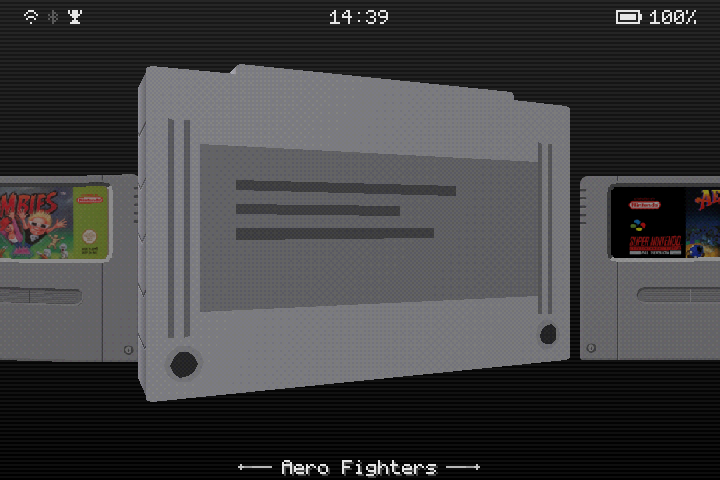
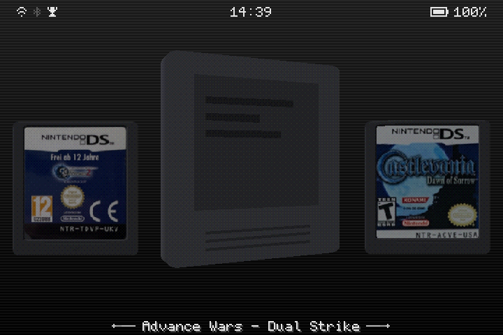
 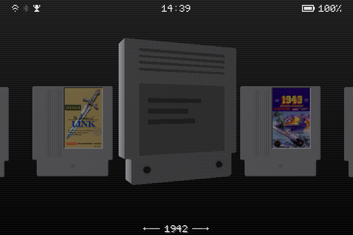
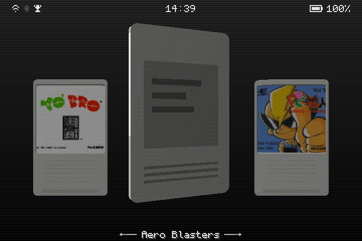
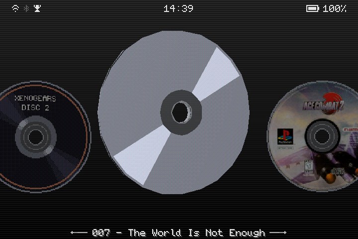
 Every cart and disc has a back, moulded the way its shell is

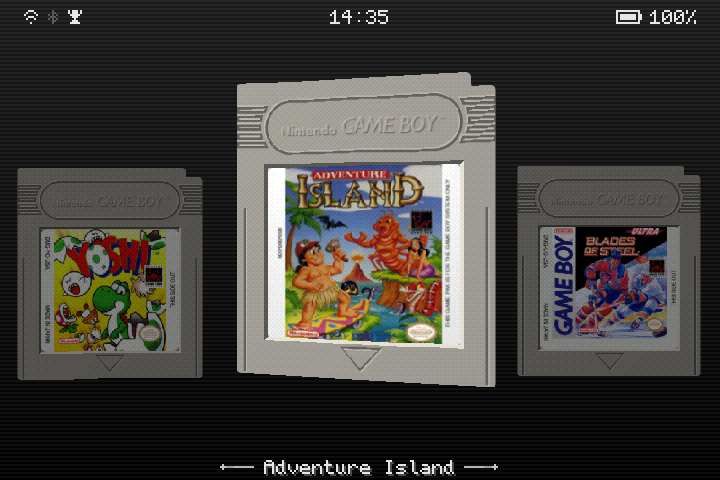

 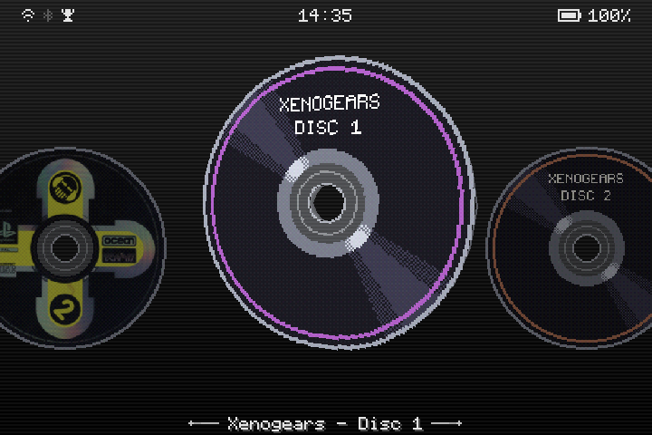
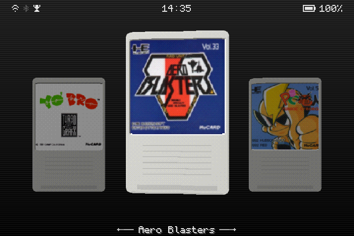
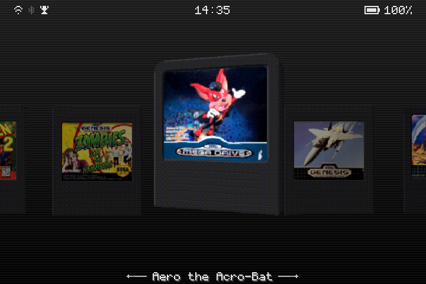
 A shelf for each system

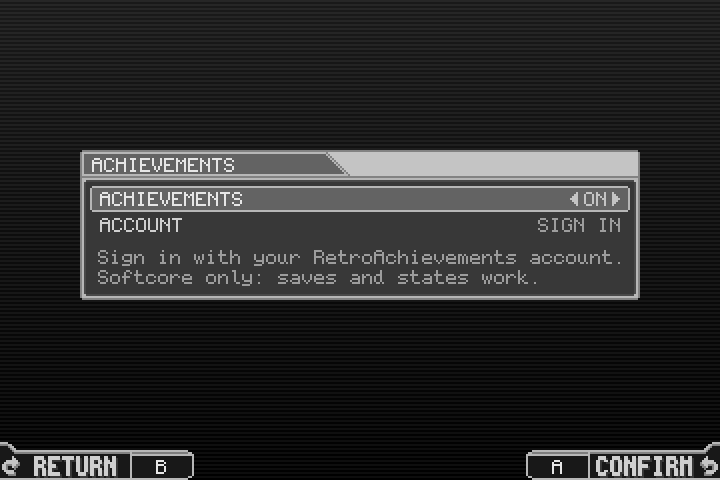
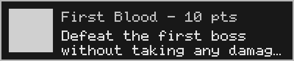
 RetroAchievements: the account, and a notice when one is earned

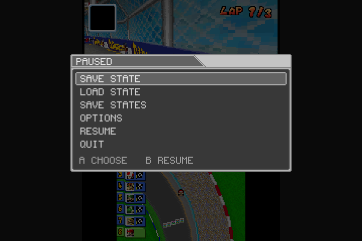
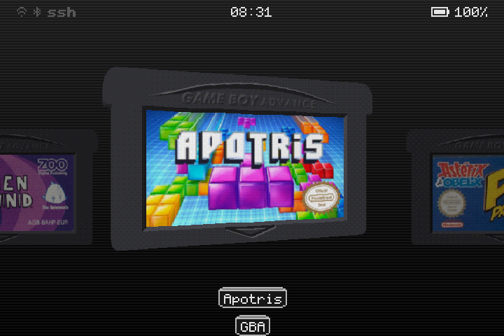
 The DS pause menu, and the shelf that opens where it was left

Every change is in the [changelog](CHANGELOG.md).

## Features

**The shelf**
- A shelf for each system, modelled low-poly with real label scans: Game Boy carts in their own
  plastics, NES carts as the grey Game Pak or a Famicom cart in its game's own colour, SNES carts
  in the American shape for a game from the USA and the Super Famicom's for the rest, Mega Drive
  carts or the American Genesis's, black Game Gear and Master System carts, PC Engine HuCards,
  pale grey or an American black TurboChip, Nintendo DS cards, and PlayStation discs, a game on
  several discs standing as a stack of them.
- The cart you are on floats and sways, and every few seconds does a trick: a twirl, two hops, a
  shake, a look aside, a cartwheel. A cart with no label scan gets a label made for it, with its
  title set as big as it will go. A pulls it down out of the screen into the handheld, and the
  game comes on like a tube TV.
- Y paints the cart in one of twelve pigments, solid, clear or glittered, kept per game.

**Playing**
- Cores: Gambatte (default) and mGBA for the Game Boys; mGBA and gpSP for the GBA, and Snes9x and
  Supafaust for the SNES, chosen per cart; DSperate for the DS; FCEUmm for the NES; Genesis Plus
  GX for the Mega Drive, with A, B and C on Y, B and A, and for the Game Gear and the Master
  System; Beetle PCE Fast for the PC Engine; PCSX ReARMed (default) or SwanStation for the
  PlayStation, with a BIOS of its own built in.
- GBA fills a 640x480 screen and the PlayStation fills it at 4:3; the NES, SNES, Mega Drive and PC
  Engine are drawn at twice their size, and Game Boy and Game Gear stay at 3x. On every
  television's console SELECT+Y goes round integer, 4:3 and stretched.
- Screen looks on SELECT+X, kept per system: LCD, grid and dot for the Game Boys and the GBA, and
  scanlines and CRT for the television's consoles, the CRT following each console's own lines.
- Resume on boot, save states with a switcher, rewind (not on the PlayStation), fast-forward,
  and turbo buttons on the Game Boys and the NES.
- A PlayStation game on several discs is one game: DISC, on SELECT+MENU in a game, puts another
  disc in, and the game resumes with the disc that was in the drive.
- Link play between two handhelds over Wi-Fi, for Game Boy and GBA games: Pokémon trades,
  Advance Wars, Mario Kart and Tetris.

**In the game**
- A short MENU press opens the game menu over the game, in three tabs that L1 and R1 turn between:
  the game's guide (`GUIDES/<system>/<game>.txt` or `.html`, with paging, scrolling and eight
  text sizes, reopened where it was left), its RetroAchievements, and the settings: what the
  hotkeys change and the options of the core that runs the game.
- A tap of SELECT opens CONTROLS: what every button does, on the shelf and in a game, on one
  panel.

**The handheld**
- Settings on START, in windows in the style of Mega Man Zero's menus that slide from screen to
  screen, over a background that keeps moving: Equalizer, 5 Games, Rumble, Labels, Achievements,
  Date & Time, Network, Bluetooth, Theme, Sleep and About on one panel.
- Network: home Wi-Fi, network time, and SSH and SFTP, each ON or OFF. Labels are fetched from
  ScreenScraper, one for each disc of a PlayStation game.
- Bluetooth, on handhelds that have it: pair a device and connect it, or forget it. Game sound and
  gamepads over Bluetooth are still to come.
- Theme: the background's pattern, its motion and its colour, which the menus and both bars take
  (Night is grey, Amber is Mega Man Zero's own), and the bottom bar's font, Bold or Thin.
- On the RG SP, RG34XX SP and RG34XX, the panel runs at 120 Hz and its colours are calibrated.
- A pixel font, a top bar with the radios, the trophy, the clock and the battery, and a bottom bar
  with the buttons.

## Screens

 The RG35XX SP in 3D, drawn the way a PlayStation drew it, with Cartridge's own screens on it: the loops play on the <a href="https://oauramos.github.io/omega-zero/">site</a>

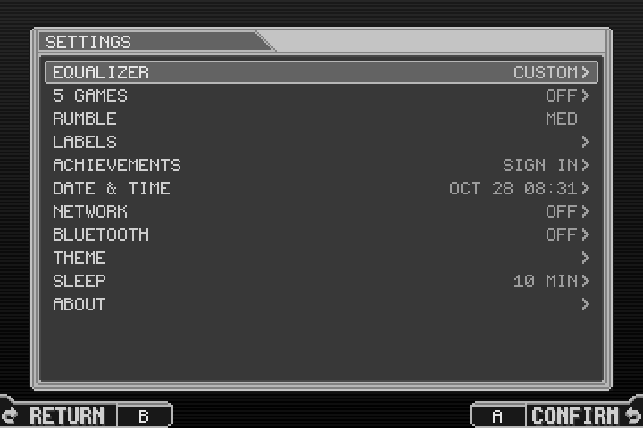
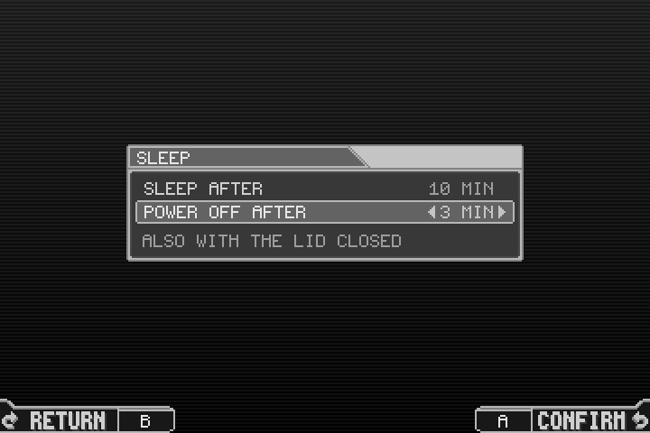
 Settings on one panel, and Sleep

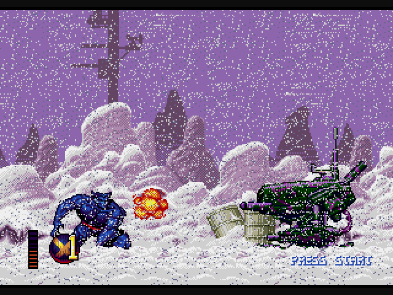
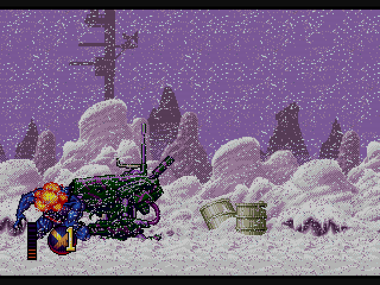
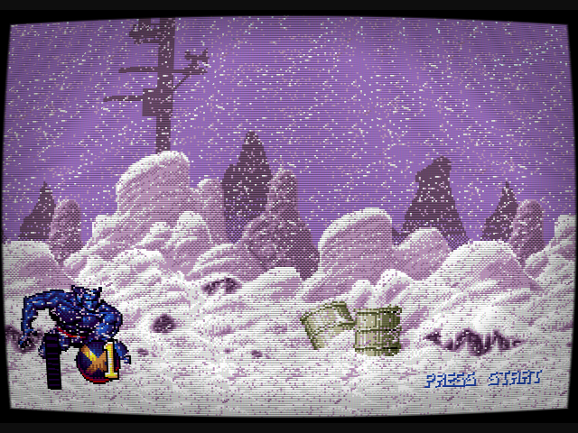
 SELECT+X goes round the screen looks of a television's console: none, scanlines, CRT

 Network and Bluetooth

 Theme, and CONTROLS on a tap of SELECT

## Supported devices

One build runs on all of them: Cartridge reads the model from BaseOS at boot and lays itself out
for its panel.

| Device | Panel | Status |
|---|---|---|
| RG35XX SP | 640x480 | Main target, in daily use |
| RG SP | 720x480 | Tested on hardware |
| RG34XX SP, RG34XX | 720x480 | RG34XX in use on hardware |
| RG35XX Plus / 2024, H, Pro | 640x480 | Untested |
| RG40XX V | 640x480 | Tested on hardware: its one stick steers as the d-pad, the screen looks and Wi-Fi work |
| RG40XX H | 640x480 | Untested (two sticks, same as the V's) |
| RG CubeXX | 720x720 | Tested on hardware: sticks as d-pad, centred layout |
| RG28XX | 480x640, turned | Experimental |

Own an untested one? A [device report](https://github.com/oauramos/omega-zero/wiki/Device-Reports)
is the most useful thing you can send.

## Quick start

1. Write the [BaseOS image](https://github.com/pvaibhav/BaseOS/releases/latest) for your model to a
   microSD card, put it in **SD1** and boot once.
2. Copy the contents of the [latest release](https://github.com/NukeBomB3000/cartridge/releases/latest)
   to the root of that card.
3. Put your games in `Games/GBA`, `Games/GB`, `Games/GBC`, `Games/NES`, `Games/SNES`, `Games/MD`,
   `Games/GG`, `Games/SMS`, `Games/PCE`, `Games/PS1` and `Games/NDS` (a `.nds`). An NES game is a `.nes`, a Mega Drive
   game a `.md`, `.gen` or `.bin`, a Game Gear game a `.gg`, a Master System game a `.sms`, a PC
   Engine game a `.pce`. A
   PlayStation game is a `.cue` with its `.bin`, a `.chd`, a `.pbp` or an `.m3u`; a real
   PlayStation BIOS, such as `scph5501.bin`, is used from `BIOS/` when it is there.
4. Boot. On the shelf, START opens Settings and a tap of SELECT shows every button.

Two cards and updating are in the site's
[install guide](https://oauramos.github.io/omega-zero/#install); controls and everything else are
in the [wiki](https://github.com/oauramos/omega-zero/wiki).

## Credits and licence

Cartridge is a fork of [omega-zero](https://github.com/oauramos/omega-zero) by **Otávio
([@oauramos](https://github.com/oauramos))**, who made nearly all of it.

- Based on [slot](https://github.com/BrandonKowalski/slot) by
  [Brandon T. Kowalski](https://github.com/BrandonKowalski) (GPL-3.0). The code that hosts the
  cores, with their saves, sound and input, is still largely his.
- [slot-fragile](https://github.com/fragilesilver/slot-fragile) by fragilesilver: the Nintendo DS
  card, the cart pigments, the idea of Gambatte and of kinder card writes, and the
  RetroAchievements client, which began in nickclyde's slot-plus. It runs on
  [rcheevos](https://github.com/RetroAchievements/rcheevos) (MIT), shipped in `System/licenses/`.
- [BaseOS](https://github.com/pvaibhav/BaseOS) by pvaibhav.
- Emulation by [mGBA](https://mgba.io) (MPL-2.0) and [gpSP](https://github.com/libretro/gpsp)
  (GPL-2.0) for the Game Boys; [FCEUmm](https://github.com/libretro/libretro-fceumm) (GPL-2.0)
  for the NES; [Snes9x](https://github.com/libretro/snes9x) (free for
  non-commercial use only) and [Supafaust](https://github.com/libretro/supafaust), Mednafen's
  snes_faust (GPL-2.0), for the SNES;
  [Beetle PCE Fast](https://github.com/libretro/beetle-pce-fast-libretro), Mednafen's pce_fast
  (GPL-2.0), for the PC Engine; [Genesis Plus GX](https://github.com/libretro/Genesis-Plus-GX)
  (free for non-commercial use only) for the Mega Drive, Game Gear and Master System; and
  [PCSX ReARMed](https://github.com/libretro/pcsx_rearmed) (GPL-2.0) and
  [SwanStation](https://github.com/libretro/swanstation) (GPL-3.0) for the PlayStation;
  [Gambatte](https://github.com/libretro/gambatte-libretro) (GPL-2.0) for the Game Boys; and
  [DSperate](https://github.com/beebono/DSperate) for the DS. Their
  licences and patches, and the source of all but mGBA, ship in `System/licenses/`.
- The card repair checks exFAT cards with fsck.exfat from
  [exfatprogs](https://github.com/exfatprogs/exfatprogs) (GPL-2.0), its source shipped beside it.
- Type is [Pixel Code](https://github.com/qwerasd205/PixelCode) by Qwerasd (SIL OFL 1.1); every
  icon is drawn as pixel art. The LCD mask is derived from GigaHerz's LCD3x.
- Cart labels come from [ScreenScraper](https://www.screenscraper.fr), fetched with your own
  account.

Cartridge is licensed under the GPL-3.0-or-later; see [LICENSE](LICENSE). omega-zero began in October
2026 as a modified version of slot, and Cartridge is a modified version of omega-zero. It is written with Claude, and reviewed and tested by its
maintainer. The site and these pictures are drawn with its
UI kit, [`assets/ui`](assets/ui).

Game Boy, Game Boy Color, Game Boy Advance, Nintendo Entertainment System, Famicom, Super Nintendo
Entertainment System and Super Famicom are trademarks of Nintendo. Mega Drive, Genesis, Game Gear and Master System are trademarks of Sega. PC Engine
and TurboGrafx-16 are trademarks of Konami. PlayStation is a
trademark of Sony Interactive Entertainment. Anbernic
is a trademark of its owner. This project is not affiliated with any of them.
